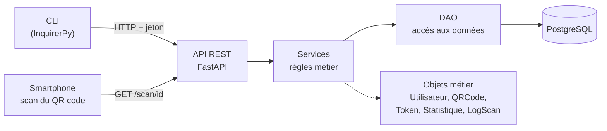
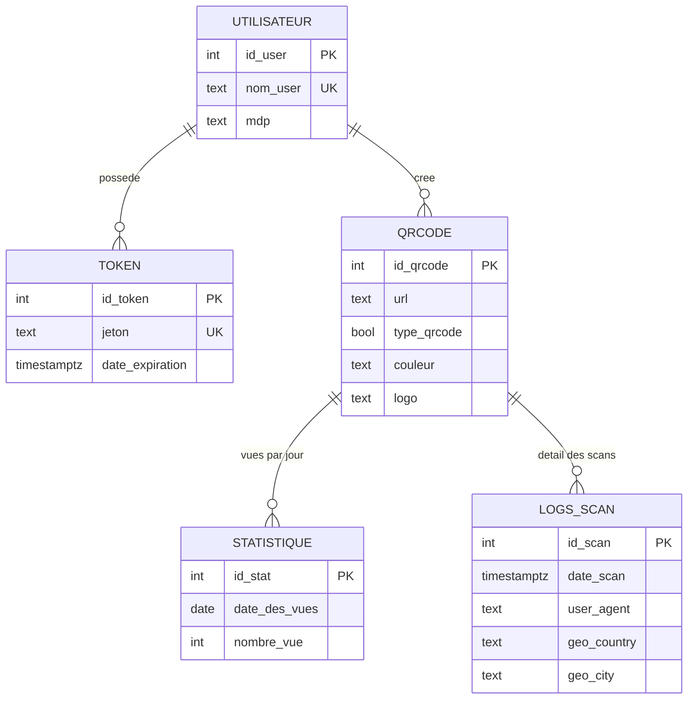

# QR Code Tracking API

[](https://github.com/AdamLaporte/qrcode-tracking-api/actions/workflows/ci.yml)

Application de **génération et de suivi de QR codes** : une API REST en FastAPI, une base PostgreSQL et une
interface en ligne de commande. Projet informatique de 2e année à l'ENSAI (septembre – novembre 2025),
réalisé à cinq.

Un QR code classique pointe directement vers son lien et ne dit rien sur son utilisation. Avec cette application, un
QR code **suivi** pointe vers l'API, qui enregistre le scan puis redirige vers la destination. Le propriétaire
consulte ensuite ses statistiques : nombre de vues par jour, appareil, langue et localisation approximative des
scans.

## Fonctionnalités

- **Comptes utilisateurs** : inscription, connexion et authentification par jeton Bearer, valable 5 heures.
- **Création de QR codes** :
  - **statiques**, qui contiennent directement le lien ;
  - **suivis**, qui passent par la route `/scan/{id}` de l'API ;
  - couleur et logo central personnalisables, image PNG servie par l'API.
- **Gestion** : lister, modifier la destination et supprimer ses QR codes. Seul le propriétaire peut agir sur un
  QR code.
- **Suivi des scans** : à chaque scan d'un QR code suivi, l'API enregistre la date, le *user agent*, la langue, le
  *referer* et une géolocalisation par IP (pays, région, ville), puis redirige vers la destination.
- **Statistiques** : vues totales, date du premier et du dernier scan, vues par jour et détail des derniers scans.

## Architecture

Le code suit une architecture en couches. Chaque couche ne dépend que de celle du dessous.



| Couche | Dossier | Rôle |
|--------|---------|------|
| Objets métier | [`src/business_object`](src/business_object) | Entités du domaine, attributs privés et propriétés |
| DAO | [`src/dao`](src/dao) | Requêtes SQL paramétrées (psycopg2), une classe par table |
| Services | [`src/service`](src/service) | Logique métier : hachage des mots de passe, droits, génération des images |
| API | [`src/app.py`](src/app.py) | Routes REST, injection de dépendances, authentification OAuth2 *password flow* |
| CLI | [`src/view`](src/view) | Menus en terminal qui consomment l'API |

### Modèle de données



### Routes de l'API

| Méthode | Route | Accès | Description |
|---------|-------|-------|-------------|
| `POST` | `/register` | public | Création de compte |
| `POST` | `/login` | public | Connexion, renvoie un jeton Bearer |
| `POST` | `/qrcode/` | jeton | Création d'un QR code (statique ou suivi) |
| `GET` | `/qrcode/utilisateur/me` | jeton | QR codes de l'utilisateur connecté |
| `GET` | `/qrcode/{id}` | public | Détail d'un QR code |
| `GET` | `/qrcode/{id}/image` | public | Image PNG du QR code |
| `PUT` | `/qrcode/{id}` | propriétaire | Modification de la destination, de la couleur, du logo |
| `DELETE` | `/qrcode/{id}` | propriétaire | Suppression |
| `GET` | `/qrcode/{id}/stats` | propriétaire | Statistiques et derniers scans |
| `GET` | `/scan/{id}` | public | Enregistre le scan puis redirige vers la destination |

La documentation interactive (Swagger) est disponible sur `/docs` une fois l'API lancée.

## Installation

Prérequis : Python 3.13 ou plus et une base PostgreSQL.

```bash
git clone https://github.com/AdamLaporte/qrcode-tracking-api.git
cd qrcode-tracking-api
python -m venv .venv && source .venv/bin/activate
pip install -r requirements.txt
cp .env.example .env   # puis renseigner les accès à la base
```

Toutes les variables sont documentées dans [`.env.example`](.env.example).

## Utilisation

Lancer l'API (terminal 1) :

```bash
python src/app.py
```

Lancer la CLI (terminal 2) :

```bash
python src/main.py
```

Au premier lancement, choisir **« Ré-initialiser la base de données »** dans la CLI : le schéma est créé et
rempli avec des données de démonstration. Ensuite, créer un compte, se connecter, puis créer un QR code
« suivi ». Le scanner avec un téléphone fait apparaître le scan dans les statistiques.

> Pour qu'un téléphone puisse scanner un QR code suivi, `SCAN_BASE_URL` doit être une adresse joignable depuis
> l'extérieur. Pendant le projet, l'API était hébergée sur la plateforme Onyxia du SSP Cloud.

## Tests

Les tests utilisent un schéma PostgreSQL dédié (`projet_test_dao`), recréé à partir des scripts SQL. Ils ne
touchent donc pas aux données de l'application.

```bash
PYTHONPATH=src pytest
```

Le projet compte **116 tests** répartis en 11 fichiers : tests d'intégration des DAO sur une vraie base, tests
unitaires des services avec des *mocks*, et tests de l'API avec le client de test de FastAPI. La couverture
atteint **85 %** sur les couches DAO et service. La CI GitHub Actions lance
toute la suite à chaque push sur une base PostgreSQL éphémère, mesure la couverture et vérifie la qualité du
code avec pylint.

## Organisation du projet

- **Conception d'abord** : diagrammes UML de cas d'utilisation, de classes, d'activité et de séquence, réunis dans
  le [rapport d'analyse](doc/rapport_analyse.pdf). Les sources PlantUML sont dans
  [`doc/diagrammes`](doc/diagrammes).
- **Suivi hebdomadaire** de l'avancement dans [`doc/suivi`](doc/suivi).
- **Répartition par entité** : chaque membre a pris en charge une entité de bout en bout (classe métier, DAO,
  service, tests), relue par un autre membre.

| Membre | Contributions principales |
|--------|---------------------------|
| **Adam Laporte** | Entité `Utilisateur`, **API FastAPI**, **interface CLI**, suivi des scans et géolocalisation, scripts de base de données, intégration et nettoyage final |
| Lesline Kenne Yonta | Entité `QRCode`, diagrammes de séquence et de classes, documentation du code |
| Mayténa Labinsky | Entité `Token` et authentification |
| Louis Roux | Entité `Statistique`, schéma de la base de données |
| Ahmed Beji | Conception de la base de données et cohérence des schémas |

## Pistes d'amélioration

- **Mots de passe** : remplacer le hachage SHA-256 salé par un algorithme lent conçu pour cet usage (bcrypt ou
  Argon2).
- **Géolocalisation** : elle repose sur le service gratuit ip-api.com, appelé en HTTP. Une base locale (GeoLite2)
  éviterait l'appel externe et protégerait mieux la vie privée des personnes qui scannent.
- **Accès aux QR codes** : le détail et l'image d'un QR code sont publics. Les réserver à leur propriétaire
  protégerait les URL de destination.
- **Déploiement** : conteneuriser l'API et la base (Docker Compose) pour lancer le projet en une commande.

## Stack

Python · FastAPI · Pydantic · PostgreSQL · psycopg2 · qrcode / segno / Pillow · InquirerPy · pytest ·
GitHub Actions

## Licence et origine

Projet construit à partir du [template du projet informatique de 2e année de l'ENSAI](https://github.com/ludo2ne/ENSAI-2A-projet-info-template)
(Ludovic Deneuville), dont l'historique est conservé. Distribué sous licence GPL v3, voir [LICENSE](LICENSE).
